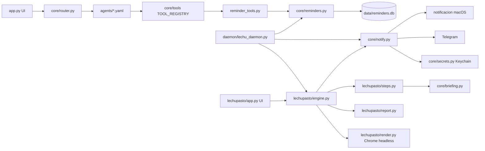

# Arquitectura de Lechu

Lechu es un asistente de escritorio para macOS, local-first, con interfaz NiceGUI y modelos de Ollama. Está en transición hacia una infraestructura de agentes que trabajan en segundo plano y le avisan a la persona. Este mapa cubre los recordatorios y LechuPasto (tareas programadas con reporte HTML); el resto se documentará de forma incremental.

Flujo de una tarea de LechuPasto: el daemon llama a `engine.run_due_tasks` cada 20 segundos; a la hora programada corre los pasos (el código trae mails y agenda, el modelo local resume), genera el HTML, le saca una captura con Chrome y la manda al bot de Telegram. La app muestra el mismo HTML en la pestaña de la tarea.

Flujo de un recordatorio: el usuario pide "recordame..." en el chat, el router elige el agente `reminders`, el modelo llama `get_current_time` y luego `set_reminder`, que guarda en SQLite. El daemon, que corre aparte de la app, lo encuentra vencido y notifica.

## Índice de módulos

- core
  - [core/reminders.py](core/reminders.md)
  - [core/notify.py](core/notify.md)
  - tools: [reminder_tools.py](core/tools/reminder_tools.md)
- daemon: [lechu_daemon.py](daemon/lechu_daemon.md)
- lechupasto: [engine.py](lechupasto/engine.md), [steps / render / report](lechupasto/steps_render_report.md), [app.py](lechupasto/app.md)
- agents: [reminders.yaml](agents/reminders.md)

Glosario: [GLOSSARY.md](GLOSSARY.md)
