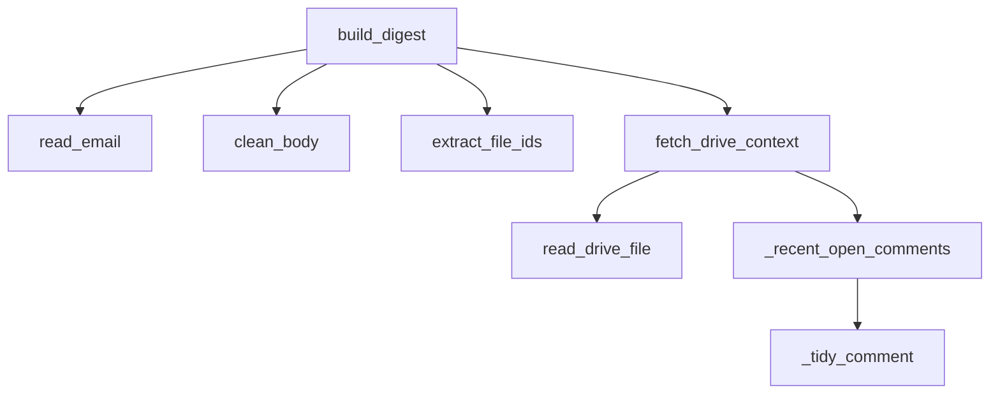

# core/mail_context.py

Convierte los resultados de búsqueda de Gmail en algo resumible: el texto completo y limpio de cada mail, más los documentos de Google (Docs, Hojas, Presentaciones) enlazados, con su contenido y sus comentarios abiertos recientes.

- `clean_body`: saca las respuestas citadas, links sueltos y marcadores de imagen; recorta a 1200 caracteres.
- `extract_file_ids`: encuentra los links de Drive en el mensaje, sin repetir.
- `_recent_open_comments`: comentarios sin resolver modificados en los últimos 14 días (máx. 8, 300 caracteres c/u); limpia las menciones `@usuario@dominio` a `@usuario`.
- `fetch_drive_context`: nombre, extracto (1500 caracteres) y comentarios de un archivo. Nunca lanza error: si no hay acceso devuelve el archivo marcado con `error`.
- `build_digest`: arma `{"emails": [...], "docs": [...]}`; cada documento aparece una sola vez aunque lo citen varios mails (máx. 6).

Por qué existe: el resumen original usaba el extracto de ~200 caracteres de Gmail, así que no veía el cuerpo de los mails largos, el texto de los comentarios ni los documentos.

Dependencias: `core.google_auth`, `core.tools.gmail_tools`, `core.tools.drive_tools`, API de Drive v3 (comentarios).

Términos: [GLOSSARY](../GLOSSARY.md)
