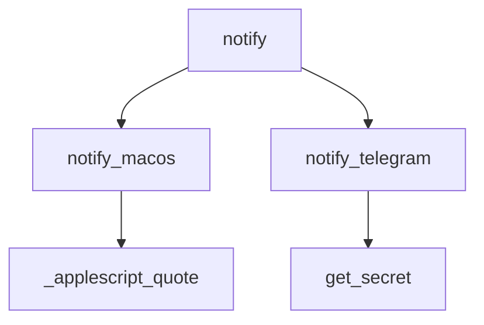

# core/notify.py

Envía un aviso al usuario por notificación de macOS y por Telegram.

## Funciones

### `notify(title, message)`
Dispara los dos canales. Si uno falla, el otro igual se envía.

### `notify_macos(title, message)`
Ejecuta `osascript` con `display notification`. Devuelve `False` si falla.

### `notify_telegram(message)`
Lee `telegram_bot_token` y `telegram_chat_id` del Keychain y llama a la API de Telegram. Si no están configurados devuelve `False` sin error. Es el mismo bot que usa el MCP `telegram-notifier` de Claude Code.

### `_applescript_quote(text)`
Escapa comillas y barras para armar el script de AppleScript.

## Notas

El logger de `httpx` se sube a WARNING a propósito: la URL de Telegram contiene el token del bot e httpx la loguea en INFO.

## Dependencias

| Tipo | Detalle |
|---|---|
| Librería | `httpx`, `subprocess`, `logging` |
| Proyecto | `core.secrets` (Keychain) |
| Externo | API de Telegram, `osascript` |

Términos: [GLOSSARY](../GLOSSARY.md)
