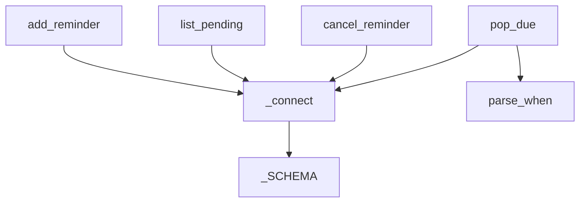

# core/reminders.py

Guarda los recordatorios en SQLite (`data/reminders.db`) y decide cuáles ya vencieron; no avisa nada, solo maneja el estado.

## Funciones

### `_connect()`
Abre la base y crea la tabla `reminders` si no existe. Devuelve una conexión con filas accesibles por nombre.

### `parse_when(value)`
Convierte `"YYYY-MM-DD HH:MM"` (también acepta `T` como separador) en un `datetime` local sin zona. Lanza `ValueError` si el formato no coincide.

### `add_reminder(message, due_at, repeat="none")`
Inserta un recordatorio pendiente. `repeat` es `none`, `daily` o `weekly`. Devuelve el registro con su `id`.

### `list_pending()`
Devuelve los recordatorios con estado `pending`, ordenados por fecha.

### `cancel_reminder(reminder_id)`
Marca como `cancelled` un recordatorio pendiente. Devuelve `True` si existía.

### `pop_due(now)`
Devuelve los recordatorios vencidos (`due_at <= now`) y los avanza en la misma transacción: los únicos pasan a `fired`; los repetitivos se reprograman al próximo horario futuro. Si la Mac estuvo dormida varios días, un recordatorio diario se dispara una sola vez, no una por cada día perdido.

## Dependencias

| Tipo | Detalle |
|---|---|
| Librería | `sqlite3`, `datetime` (estándar) |
| Proyecto | `config.DATA_DIR` |

Términos: [GLOSSARY](../GLOSSARY.md)
