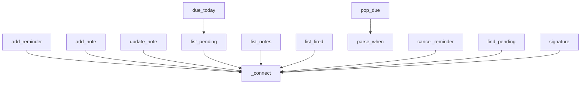

# core/reminders.py

Guarda recordatorios y notas en SQLite (`data/reminders.db`) y decide cuáles recordatorios ya vencieron; no avisa nada, solo maneja el estado.

Una sola tabla para los dos tipos, así comparten espacio de ids y se pueden cancelar o borrar igual. Un recordatorio es un ítem con fecha (`kind='reminder'`); una nota es un ítem sin fecha, con título (`message`) y contenido largo (`body`) (`kind='note'`). Las columnas nuevas se agregan solas a bases existentes (`_connect` migra).

## Funciones

- `parse_when(value)`: `"YYYY-MM-DD HH:MM"` a `datetime` local.
- `add_reminder`, `list_pending` (solo recordatorios, por fecha), `list_fired` (historial), `due_today(now)` (los que quedan pendientes hoy).
- `pop_due(now)`: devuelve los vencidos y los avanza (los únicos pasan a `fired`; los repetitivos se reprograman al próximo horario futuro, así que una Mac dormida varios días dispara una sola vez). **Las notas nunca se disparan.**
- `add_note`, `update_note`, `list_notes` (más recientes primero).
- `cancel_reminder(item_id)`: cancela un recordatorio o borra una nota (marca `cancelled`).
- `find_pending(match)`: ítems pendientes cuyo texto o contenido contiene las palabras dadas; permite pedir "borrá la nota de la imprenta" sin conocer el id.
- `signature()`: detector barato de cambios; la pantalla de Recordatorios lo consulta cada 3 segundos para reflejar lo que cree el chat o Lechu.

Ojo operativo: el daemon carga este módulo al arrancar. Después de cambiar su lógica hay que reiniciarlo (`launchctl kickstart -k gui/$(id -u)/com.lechu.daemon`); con la versión vieja, las notas se "disparaban" como recordatorios.

Términos: [GLOSSARY](../GLOSSARY.md)
