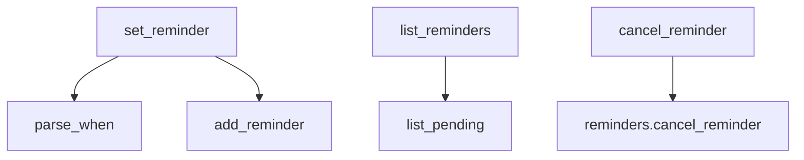

# core/tools/reminder_tools.py

Expone los recordatorios al modelo como tres tools registradas en `TOOL_REGISTRY`.

## Tools

### `set_reminder(message, when, repeat="none")`
Valida `repeat` y el formato de `when`, rechaza horarios ya pasados (salvo repetitivos) y guarda. Devuelve el registro o `{"error": ...}`. El mensaje de error le indica al modelo que use `get_current_time`.

### `list_reminders()`
Devuelve `{"reminders": [...]}` con los pendientes.

### `cancel_reminder(reminder_id)`
Cancela por id. Devuelve `{"cancelled": id}` o un error.

Ninguna requiere confirmación: son acciones locales y reversibles.

## Dependencias

| Tipo | Detalle |
|---|---|
| Proyecto | `core.reminders`, `core.tools` (`Tool`, `register`) |
| Usada por | `agents/reminders.yaml` |

Términos: [GLOSSARY](../../GLOSSARY.md)
