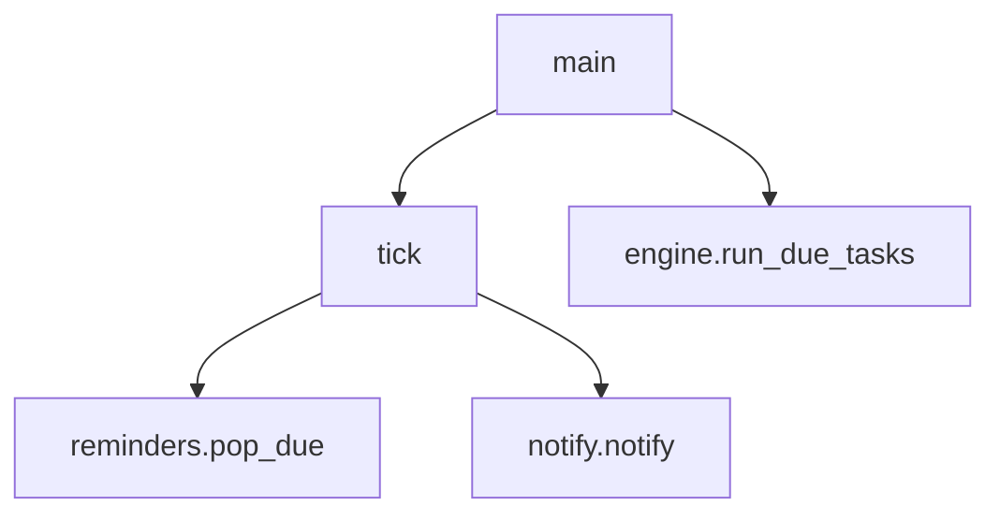

# daemon/lechu_daemon.py

Proceso en segundo plano que cada 20 segundos busca recordatorios vencidos y los notifica, con la app cerrada.

## Funciones

### `tick()`
Pide los recordatorios vencidos y notifica cada uno con el título "Lechu Recordatorio".

### `main()`
Bucle infinito: `tick()` y `engine.run_due_tasks()` y espera `POLL_SECONDS` (20). Una excepción en un ciclo se registra y no mata el proceso.

## Instalación

`daemon/install_daemon.sh` genera `~/Library/LaunchAgents/com.lechu.daemon.plist` y lo carga con `launchctl bootstrap`. Arranca al iniciar sesión, se reinicia solo (`KeepAlive`) y escribe en `data/lechu_daemon.log`. No usa el modelo: no depende de Ollama.

## Dependencias

| Tipo | Detalle |
|---|---|
| Proyecto | `core.reminders`, `core.notify` |
| Sistema | launchd |

Términos: [GLOSSARY](../GLOSSARY.md)
