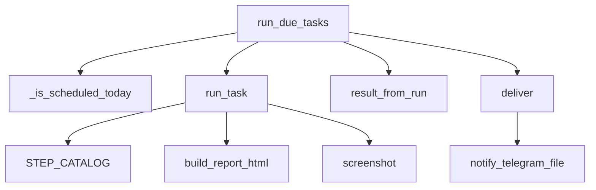

# lechupasto/engine.py

Carga las tareas de `tasks/<id>/task.yaml`, ejecuta su pipeline, escribe el reporte HTML y la captura, y la entrega por Telegram.

## Piezas

- `Task` / `RunResult`: la definición de una tarea y el resultado de una corrida.
- `load_tasks()`: lee todos los `task.yaml`.
- `run_task(task, now, scheduled)`: ejecuta los pasos en orden, armando un contexto con la salida de cada uno; arma el reporte con las secciones declaradas, lo guarda en `runs/<id>.html` y le saca la captura. Las corridas programadas usan la fecha como id (una por día); las manuales agregan la hora para no pisarlas.
- `deliver(task, result)`: manda la imagen por el bot (como documento si es muy alta); sin captura, manda texto.
- `run_due_tasks(now)`: lo llama el daemon cada 20 segundos. Corre cada tarea una vez por día desde su hora, también al despertar la Mac. Si la corrida ya existe pero no se envió, solo reintenta el envío cada 10 minutos.
- Estado en `runs/<id>.json` (título, hora, si se entregó). `runs/` está en `.gitignore`.

Dependencias: `core.notify`, `lechupasto.render`, `lechupasto.report`, `lechupasto.steps`, `yaml`.

Términos: [GLOSSARY](../GLOSSARY.md)
